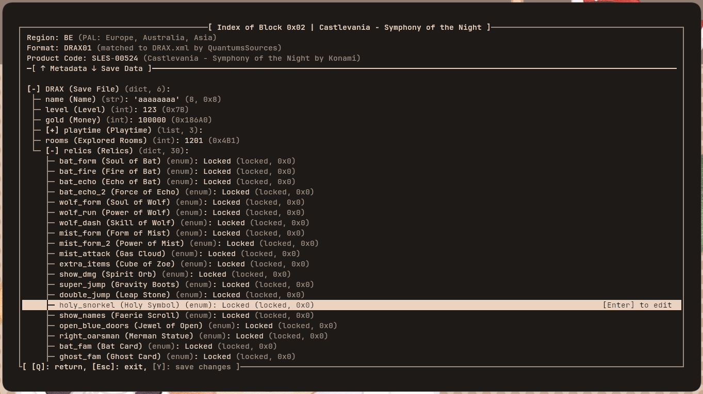
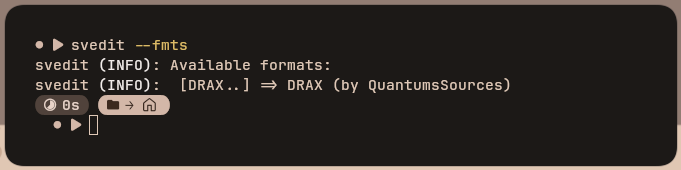
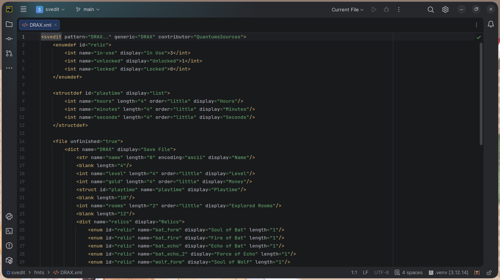

<div align="center">

# svedit
Global PlayStation© 1 save editor.\
Made with ♥ by quantum.


<br>
<sub><b>Figure 1</b>: Block picker example, with block <code>0x03</code> selected</sub>
</div>

> [!important]
> `svedit`'s format library is currently **very limited**!\
> Support is limited to one game, Symphony of the Night, and even then,
> it's still not completely finished!
> 
> If you're interested in adding support for a game you really like, scroll
> down to **Contributing**!

## Features
### Intuitive UI, built with UX in mind
- `svedit` features an intuitive, easy to use, terminal interface.
- Quickly take a glance at any relevant metadata in your memory card, before diving into the save editor.
- It will also automatically download everything it needs to run on first startup (see below).
- Additionally, `svedit` makes it super easy to get started with collaboration!

<div align="center">

<br>
<sub><b>Figure 2</b>: svedit's editor interface, editing Castlevania - Symphony of the Night</sub>
</div>

> [!note]
> Whenever you come across a format marked as "unfinished", `svedit` will let you know at the bottom!\
> If you wish, you can also have `svedit` generate a `CONTRIBUTE.py` script as a  one-click solution, to make
contributions as easy as possible.

> [!note]
> When you first run `svedit`, it'll automatically download everything it needs to function.\
> After that, you can fully use it without an active internet connection.
> 
> For full transparency, here's a list of everything it does on first launch (might be subject to expansion):
> 1. Download the PSX game database from DuckStation, [this file](https://raw.githubusercontent.com/stenzek/duckstation/refs/heads/master/data/resources/gamedb.yaml),
by default;
> 2. If used with `--force-dl --db-src=<source>`, download content at `<source>` instead;
> 3. Cache it into a `.pkl` file for quicker startup times;
> <div align="center">
> 
> <br>
> <sub><b>Figure 3</b>: svedit downloading the PlayStation© game database</sub>
> </div>

### Built for collaboration
- To see a list of currently supported formats, run `svedit --fmts`.
- If you're interested in helping out, scroll down to **Contributing**!
- After your entry gets accepted, your name will show up inside `svedit`, both in the terminal, and the
interface!

<div align="center">

<br>
<sub><b>Figure 4</b>: svedit's current (12/06/26) list of supported formats (Help expand it!)</sub>
</div>

## Installation
> [!important]
> Currently, `svedit` only works on **Linux and Android**<sub>(through Termux)</sub>.\
> This is due to the program's use of Python's `termios` and `tty` libraries, which are only available
on Unix-based systems.
> 
> It *might* run on Windows through the **Windows Subsystem for Linux (WSL)**, but it is not tested!\
> A native macOS release will depend solely on contributions or community forks.

### Prerequisites
To build `svedit`, you'll need...
1. python 3.10+ (3.12+ recommended);
2. nuitka (arch: `yay -S nuitka`, deb: `sudo apt install nuitka`, etc...);
3. pyyaml (arch: `sudo pacman -S python-yaml`, deb: `sudo apt install python3-yaml`, etc...)

### Instructions
#### Download prebuilt release
1. Head over to the "Releases" page on the side (or above if you're on GitHub mobile);
2. Download `svedit-{...}.tar.gz` from that page;
3. Unpackage it and run `svedit.bin`.

> [!note]
> `svedit`'s prebuilt release doesn't automatically link the binary to your `~/.local/bin` folder.
> 
> To do so, you can `link` the `svedit.bin` file to `~/.local/bin/svedit`:
> ```bash
> # In the unpacked release folder
> link svedit.bin ~/.local/bin/svedit
> ```

#### Build from source
After installing the dependencies above, you can...

1. Clone this repository;
```bash
git clone https://github.com/QuantumsSources/svedit.git
cd svedit
```
2. Run the installation script inside;
```bash
python build.py
```

## Contributing
Thank you for showing interest in contributing to `svedit`!\
If you've enjoyed using `svedit` and want to help out, there's two (or three) main ways to do so:

### 1. Providing Formats
`svedit` is, fundamentally, set up on a foundation of collaboration.\
As much as I'd love to spare you the time, I can't reverse engineer every single PSX save file format in the
world.

**That's where you come in!**

If you have the time, and the patience, you can just hop on whatever PSX game you like and
try to decipher its save file.

I highly recommend another tool of mine, built practically specifically for this purpose,
**selfhex**. You can download it [here](https://github.com/QuantumsSources/selfhex).

> [!note]
> `selfhex` also uses `nuitka` for building, and relies on no external dependencies.\
> If you have any issues with it, though, report them on its repository, not this one.

I also recommend reading over the documentation of the XML structure `svedit` expects in `XML_DOCS.md`.

<div align="center">

<br>
<sub><b>Figure 5</b>: Editing <code>DRAX.xml</code>. Note the XML structure.</sub>
</div>

Once you've decided to start (again, **thank you**!), do this:
1. Fork this repository.
2. Clone your fork.
3. If your game's format ID isn't available yet (check with `svedit --fmts` or `svedit --fmt-available=<fmt>`),
you can start reverse engineering it.
4. After you're done (might take a while!) making the XML translation layer, push it to GitHub, start a pull
request, and wait for it to be accepted.

> [!note]
> If you find it easier, `svedit` can generate a `CONTRIBUTE.py` file that does everything above under an
> easy-to-use, interactive interface.
> 
> To do it, launch `svedit` with a memory card file that contains a game with no format file, then open it.\
> Afterward, scroll all the way down, press **Enter**, and run `CONTRIBUTE-%fmt.py` (change `%fmt` with the
> actual format ID).

> [!note]
> If you'd like, you can add your GitHub name, etc... (no links, sorry!) in your XML file's root 
node as an attribute `contributor`.\
> Like this:
> ```xml
> <svedit pattern="..." generic="..." contributor="QuantumsSources"/>
> ```
> 
> I don't mind at all, I think it's a great way to show off your contribution!

> [!note]
> Even if contributions are low, I can't promise quick responses!\
> Thank you for your consideration, and please don't think I'm actively ghosting you!
> 
> If there are any issues with your contribution, I'll let you know what they are.
> Additionally, if you have any questions or concerns, open an issue about it.

### 1.1. Updating Formats
If you find a format that matches on one or more of the below criteria, you can also update it.

You can update a format if it falls into one or more of these criteria:
- Hard to understand (e.g. unnecessary `enum` or `struct` tags, etc...);
- Weirdly formatted (e.g. unnecessary `dict` or `list` tags, etc...);
- Incorrect (e.g. incorrect `checksum` ranges, etc...);
- Incomplete (note if they have `unfinished="true"` under their `file` tag);

Doing so follows a similar pattern to creating a new format file:
1. Fork this repository.
2. Clone your fork.
3. Edit the file.
4. Start a pull request and wait for it to be accepted.

> [!note]
> If you find it easier, `svedit` can generate a `CONTRIBUTE.py` file that does everything above under an
> easy-to-use, interactive interface.
> 
> To do it, launch `svedit` with a memory card file that contains a game with an unfinished format file and open it.\
> Afterward, scroll all the way down, press **Enter**, and run `CONTRIBUTE-%fmt.py` (change `%fmt` with the
> actual format ID).

> [!note]
> If you'd like, you can also claim credit for updating a file, though obviously don't remove the original author.\
> Here's an example:
> ```xml
> <svedit contributor="QuantumsSources, <you>" pattern="..." generic="..."/>
> ```
> The rule is exactly the same, you can put in your GitHub username, etc..., but no links!

### 2. Bug fixes and new features
Like most open-source projects, `svedit` accepts code contributions from others!\
If you know what you're doing, and know some Python, this is also a great way to help out! 

To help out with bugs or features, here's what you'll need:
1. All of `svedit`'s dependencies (see above, under **Installation**);
2. A code editor (e.g. `vim`, `pycharm`, `vscodium`);
3. A lot of patience;

After you meet all the above prerequisites, you can get started on your contribution:
1. Fork this repository.
2. Clone your fork.
3. Make your changes there, and test them out locally.
4. After you're done, push them to GitHub and start a pull request.

> [!note]
> Even if contributions are low, I can't promise quick responses!\
> Thank you for your consideration, and please don't think I'm actively ghosting you!
> 
> If there are any issues with your contribution, I'll let you know what they are.\
> Additionally, if you have any questions or concerns, open an issue about it.

## Footnotes
> [!important]
> Much like `svedit` downloads **DuckStation's game database** off of GitHub, `svedit`'s entire format library
(aka, anything in `./fmts/`), which, as part of `svedit`, is also licensed under GPLv3 (or later), is freely
available for download by anyone at all.
> 
> _No_, you _don't_ need to ask for permission, go right ahead.

> [!important]
> `svedit` is actively tested out on multiple terminals.
> 
> Here's what you can expect:
> 1. `kitty`: The one I use to develop `svedit`, best experience overall.
> 2. `alacritty`: Also on par with `kitty`.
> 3. `konsole` / `gnome-terminal`: You might experience some flickering, though usually nothing major.
> 4. `tty`: Functional *(-ish)*, though with frequent flickers and no RGB color.
> 5. `cmd` / `powershell`: `svedit` is not tested on Windows or WSL.

> [!note]
> The icon for `svedit` is ~~stolen~~ borrowed from Sonic the Hedgehog 3.\
> Original sprite by SEGA and Sonic Team, with minimal edits by me.

<div align="center">
(woah, it's not so empty down here anymore...)
</div>